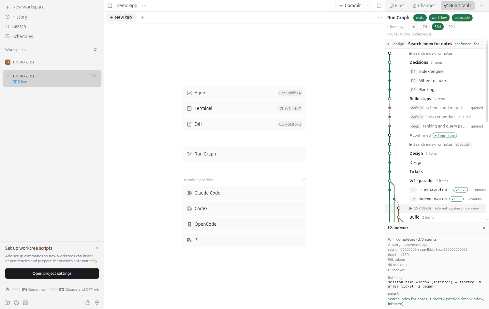
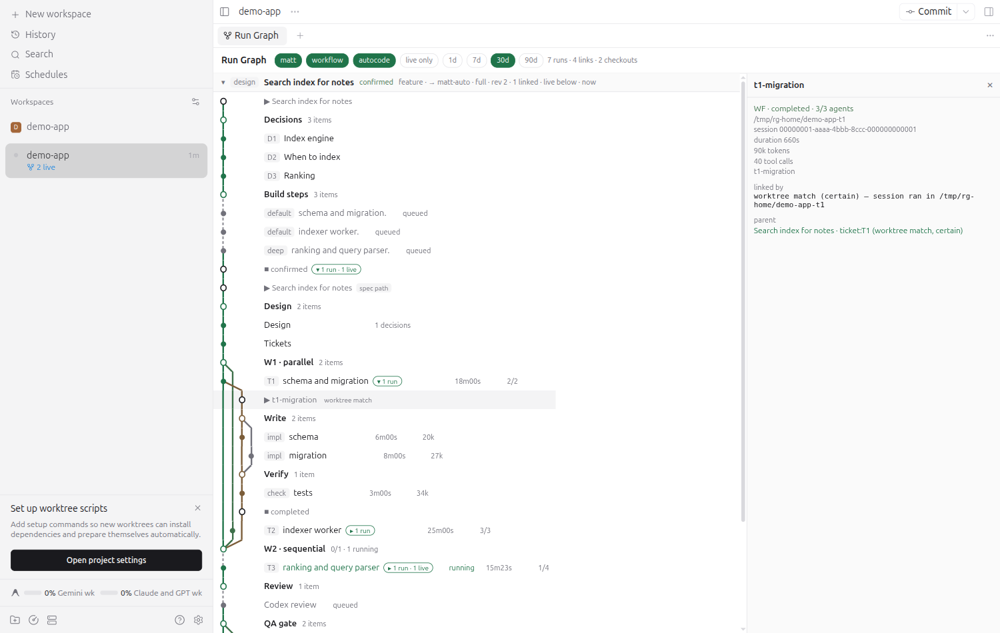
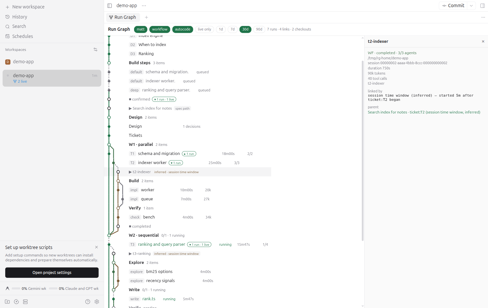

# Run Graph (Paseo plugin)

Run Graph shows the runs of a repository in one workspace panel, as one lane graph per top-level run:

- matt-design specs
- matt-auto and autocode runs
- the qa-gate, review-gate and pr-visual results of those runs
- Claude workflow runs and plain subagents

A run that another run started is drawn as a collapsible sub-graph. It forks from the node that started it and merges back into whatever follows that node.

```
matt-design spec ─▶ matt-auto run ─▶ waves ─▶ tickets ─▶ workflow runs / subagents a ticket's worker started
                                   └▶ Review ─▶ QA gate ─▶ Review gate (rounds, verdict) ─▶ PR visual ─▶ PR checks
autocode run ─▶ experiments ─▶ workflow runs / subagents an experiment's worker started
standalone workflow run ─▶ phases ─▶ agents
```





## Contributions

- **Run Graph panel** (`addWorkspacePanel`, `locations: ["explorer", "workspace"]`): the lane graph and a detail pane.
  - **Where it lives.** It lives in the right sidebar (Explorer), next to Files and Changes, and can also open as a workspace tab.
  - **Narrow layout.** The panel is not told where it is, so it measures its own width. Below 640 px (the sidebar, phones), rows fit the width, labels truncate, the sub column hides, and the detail pane moves below the graph.
  - **Filters and state.** Filters are source, live only, and 1, 7, 30 or 90 days. Filter, open and expand state persist per tab.
- **Open Run Graph** (`addCommandCenterItem`): opens the panel in the right sidebar. **Open Run Graph in a tab** opens it as a workspace tab.
- **Live runs badge** (`addWorkspaceRowBadgeItem`): "n live" under each workspace in the sidebar.
- **Server RPCs:**
  - `runs.list(workspacePath, days?)` returns every run (items without prompts or notes), the edges, the checkouts and any read errors.
  - `runs.detail(workspacePath, runId)` returns one run with its prompts, results, notes and findings.
  - `runs.live-count(workspacePath)` returns the number of live runs.

## Data sources

All paths are read-only. Loop files are searched in every checkout from `git worktree list --porcelain -z`, not only in the workspace folder.

| Source | Files | Writer (weed-harness 7.4 "purpose loops") |
|---|---|---|
| matt-design spec | `docs/design/<slug>.md` with frontmatter `matt-design: 1` (or legacy `design-map: 1`): `slug`, `revision`, `kind` (feature / optimize / research), `loop`, `mode`, `status`. The `## 결정` table becomes the decisions and `## 구현 순서` the build steps. | plan session (`matt-design`) |
| legacy matt-design run | `out/design/*/run.data.json` (stages and tickets) | older design-map |
| matt-auto board | `docs/agents/matt-auto-log/<slug>.data.json` (also `scratch/matt-auto-log`) | build session, full mode. Fields used: `stages`, `tickets[]`, `plan.waves`, `review.passes`, `pr`, `progress` |
| matt-auto log | `<slug>.md` beside it. It is the only record of a core-mode run, and is listed as a run only when there is no `.data.json` | build session |
| autocode | `.autocode/report/autocode.data.json` (`run`, `hypotheses[]`), plus `program.md` for the `spec:` line and `state.json` | build session (`autocode`) |
| qa-gate | `.qa/<unit>/result.json` and `plan.json` | `qa-gate` |
| review-gate | `.review/<unit>/round-<n>.json`, `triage-<n>.json` and `verdict.json`. A PASS whose `reviewed_sha` is no longer HEAD shows as **stale**. | `review-gate` |
| pr-visual | `.pr-visual/<unit>/changes.json` and `changes.html` | `pr-visual` |
| Claude workflow runs | `~/.claude/projects/<enc-cwd>/<session>/workflows/wf_<id>.json` (final record), `workflows/scripts/<name>-wf_<id>.js` (`meta.phases`), and `subagents/workflows/wf_<id>/agent-*.jsonl` + `.meta.json` (live agents) | Workflow tool |
| Claude subagents | `~/.claude/projects/<enc-cwd>/<session>/subagents/agent-*.jsonl` + `.meta.json`, one run per session, grouped by agent type | Agent tool (matt-auto full mode without hc, autocode strategist and experimenters) |

`<unit>` is `matt-auto-<slug>` or `autocode-<slug>`.

How runs are read:

- **Workflow status.** A workflow run without a final record is live. If none of its files changed for 180 s, it is **stopped**, and its running agents are shown as stopped.
- **Transcript reads.** Only the first line and the last 128 KB of a transcript are read.
- **Which Claude runs belong to a repo.** A Claude run belongs to a repository when either holds:
  - its session ran in a checkout of the repository, or in a folder below one;
  - its session ran in a worktree that a ticket or hypothesis names.
- **Caching.** Every parse is cached by file mtime. The panel polls every 3 s while a run is live and every 15 s otherwise. React Query stops polling when the panel closes. The sidebar badge polls every 30 s, and the server answers repeated calls within 1.5 s from memory.

## Linking rules and confidence

`server/link.ts` builds the parent → child edges. Every edge records its evidence and a short detail, which the detail pane shows. A run gets at most one parent: the first rule that matches wins. An edge that would close a cycle is refused.

| Order | Rule | Evidence | Confidence | Drawn |
|---|---|---|---|---|
| 1 | A ticket's or hypothesis's data names the workflow `runId` (`wf_…`), the Claude session id, or one of the run's agent ids. The run's own text is checked next (the `.md` decision log, autocode `program.md` / `state.json`), which links to the run itself. | `explicit id` | certain | solid |
| 2 | The run's Claude project dir is the ticket's `worker.worktree` with every non-alphanumeric character replaced by `-`, or one of its agents' transcript `cwd` is that worktree. Free text such as "Workflow worktree" is not a path. | `worktree match` | certain | solid |
| 3 | The run started inside a ticket's or hypothesis's window. The window is `startedAt` to `startedAt + actualMin`; while the ticket runs it ends now; without `actualMin` it ends at twice `estimateMin`. Allow ±60 s. The latest-starting item that contains the run wins. | `session time window` | inferred | dashed, labelled "inferred" |
| 3b | Rule 3 found nothing, but the run started inside the build run's own `[progress.startedAt, progress.updated]` and its session ran in that run's checkout. It links to the build run itself. | `run time window` | inferred | dashed |
| 4 | matt-design → matt-auto / autocode, in this order: the build names the spec path (the design stage note or `.md` log, or the autocode `spec:` line; compared both absolute and repo-relative); then the same slug; then the same title. | `spec path` / `design slug` / `design title` | certain | solid, from the spec's end node |

A run with no parent stays top-level. A child whose parent is hidden by a filter also stays top-level. No run is dropped.

## Layout

`shared/lanes.ts` is the git-graph lane algorithm from the Herdr mods, and `shared/graph.ts` turns runs into commits. Each phase places its items in one of three modes:

| Mode | Used for | Placement |
|---|---|---|
| `time` | workflow agents, autocode experiments | Lanes follow real start and end overlap. A lane is reused once its item ended. |
| `parallel` | parallel waves, QA scenarios, PR checks | Every item forks from the phase. |
| `sequential` | design stages, sequential waves, review and review-gate rounds | Items chain one after another. |

More layout rules:

- **Without `plan.waves`.** Tickets are grouped into columns by `blockedBy` level (`shared/dag.ts`). A cycle or an unknown dependency becomes an error on the run, and the offending edge is dropped, so the layout always finishes.
- **Collapsed children.** Child runs are collapsed by default. The parent node shows "▸ n runs", plus "· k live" when a run below it is live.
- **Opening order.** Top-level runs with a live run anywhere below them sort first and start open.

## Develop

```bash
npm install
npm run typecheck
npm test                      # node --test, fixtures under test/fixtures
paseo plugin install "$PWD"   # then: paseo plugin reload run-graph
```

To get a demo without touching `~/.claude`, run a second daemon with its own HOME:

```bash
node scripts/make-demo.mjs /tmp/rg-home        # repo, worktree, and Claude runs under /tmp/rg-home
# /tmp/rg-home/.paseo/config.json:
# {"version":1,"daemon":{"listen":"127.0.0.1:6868","relay":{"enabled":false}},"pluginsEnabled":true}
HOME=/tmp/rg-home paseo daemon start --home /tmp/rg-home/.paseo
HOME=/tmp/rg-home paseo plugin install "$PWD" --home /tmp/rg-home/.paseo
HOME=/tmp/rg-home paseo workspace create --isolation local --path /tmp/rg-home/demo-app --home /tmp/rg-home/.paseo
```

## Known gaps

- **No explicit ids in the loop data today.** The weed-harness 7.4 data files carry no `wf_…`, session or agent ids, and `worker.dispatchId` is an hc terminal name. Run ids appear only in the matt-auto `.md` log, as free text. Rule 1 matches only when someone writes an id there, so most real links come from rules 2 and 3.
- **hc workers are invisible.** hc-worker state (`<run>.hc.json`) has no fixed location and is not read. Workers in Herdr terminals, Grok lookups (`~/.grok/sessions`), and Codex reviewers (`codex exec`) do not show as runs. Only their results in `.review/` and `.qa/` do.
- **Core mode has no board.** It writes only the `.md` log, so a core run appears as sections of a decision log plus its gates. There are no tickets and no time windows to link by.
- **One autocode run per checkout.** autocode always writes `autocode.data.json`, so a new run in the same checkout replaces the old one.
- **Coarse subagent links.** Plain subagents are one run per session. A single subagent cannot be linked to a single ticket; the whole session run links to it.
- **Cwd encoding is lossy.** Claude encodes a cwd by replacing every non-alphanumeric character with `-`, so `/a/b-c` and `/a/b/c` look the same.
- **Free-text spec structure.** Spec decisions and steps are parsed from the `## 결정` table and the numbered `## 구현 순서` list. A spec written another way shows only its frontmatter facts.
- **Real data has no links yet.** On the author's machine (2026-11-26), no repository had both a matt-auto log and Claude workflow runs, so every rule found zero links there. The screenshots use the generated demo.
